

<a href="https://gabrielmsorensen.github.io/g4t0xx-portfolio/">
  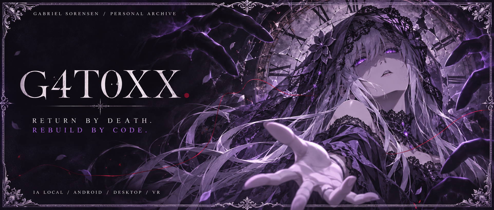
</a>

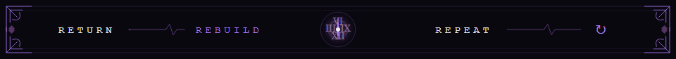

**Gabriel Sorensen · G4T0XX**

Crio entre mundos: <strong>inteligência artificial local, Android, desktop, web e VRChat</strong>. 
Também exploro avatares, modelagem 3D, áudio e edição com IA. 
Re:Zero é meu anime favorito. Aqui, cada falha vira conhecimento para o próximo loop.

<strong><a href="https://gabrielmsorensen.github.io/g4t0xx-portfolio/">PORTFÓLIO ↗</a></strong> &nbsp; · &nbsp; <strong><a href="https://github.com/GABRIELMSORENSEN?tab=repositories">REPOSITÓRIOS ↗</a></strong> &nbsp; · &nbsp; <strong><a href="https://youtube.com/@xg4t0xx">YOUTUBE ↗</a></strong> &nbsp; · &nbsp; <strong><a href="https://www.instagram.com/g4_wps/">INSTAGRAM ↗</a></strong>

<picture>
  <source media="(prefers-reduced-motion: reduce)" srcset="assets/eyes-still.png" />
  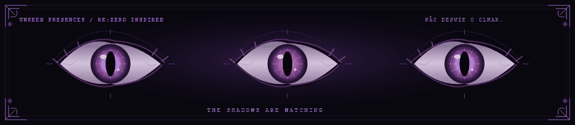
</picture>

 

<table>
<tr>
<td align="center" width="55%">
<a href="https://tenor.com/view/natsuki-subaru-return-by-death-re-zero-anime-subaru-gif-6207545841974046974">
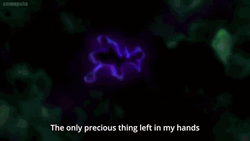
</a>
</td>
<td align="center" width="45%">
</td>
</tr>
</table>


<table>
<tr>
<td width="50%"><a href="https://github.com/GABRIELMSORENSEN/POLIGON-ASSISTENT-AI">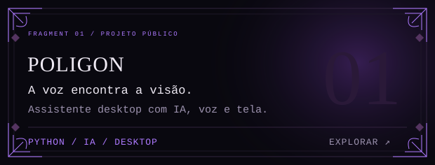</a></td>
<td width="50%"><a href="https://github.com/GABRIELMSORENSEN/Forge-Mobile">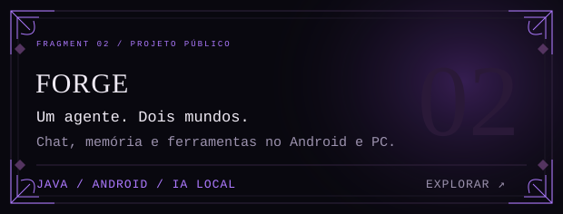</a></td>
</tr>
<tr>
<td><a href="https://github.com/GABRIELMSORENSEN/GatoFocus-VR">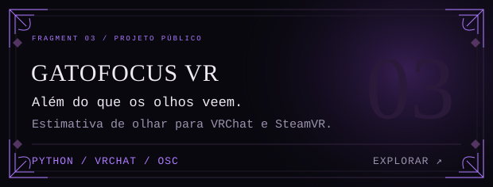</a></td>
<td><a href="https://github.com/GABRIELMSORENSEN/PORSUIT-REMOTE">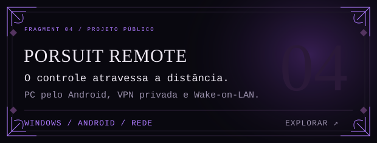</a></td>
</tr>
<tr>
<td><a href="https://github.com/GABRIELMSORENSEN/GATARME">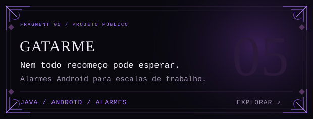</a></td>
<td><a href="https://github.com/GABRIELMSORENSEN/mania-chart-studio">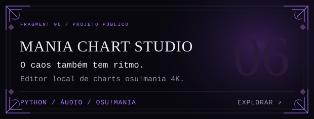</a></td>
</tr>
<tr>
<td><a href="https://github.com/GABRIELMSORENSEN/g4-docs-editor">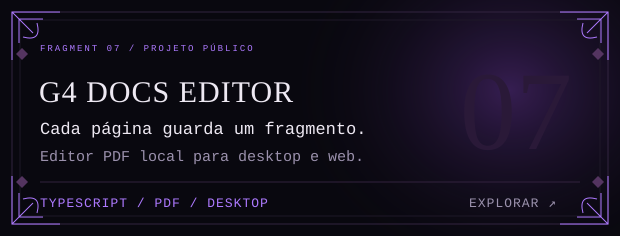</a></td>
<td><a href="https://github.com/GABRIELMSORENSEN/g4t0xx-portfolio">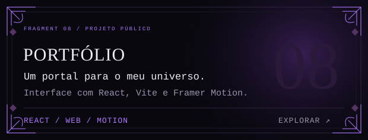</a></td>
</tr>
</table>

Entre no repositório de cada projeto para ver estado, instalação e limitações.


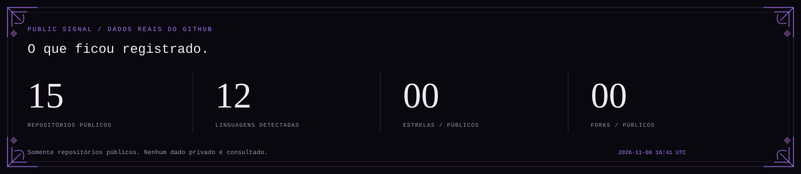
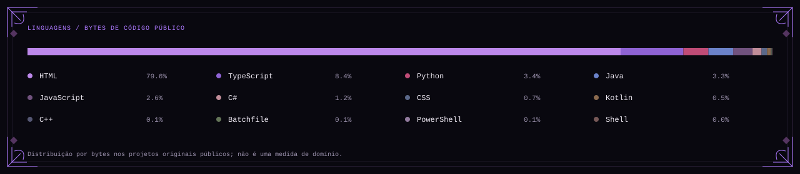
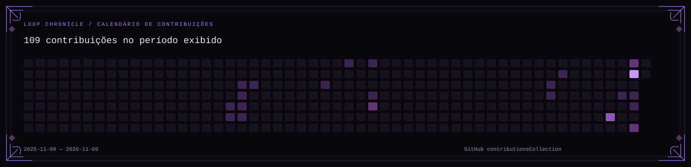

Dados reais do GitHub. Linguagens são medidas por bytes de código, não por nível de domínio. O calendário segue as regras de visibilidade do GitHub. [Dados e atualização](data/public-metrics.json).


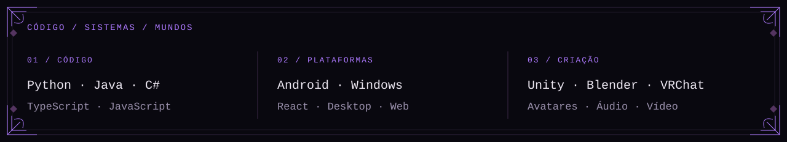

 

**[LINKEDIN ↗](https://www.linkedin.com/in/gabriel-matos-sorensen-a16672406/)** &nbsp; · &nbsp; **Discord: `g4_wps`**


Fan profile inspirado em Re:Zero · sem afiliação oficial. GIF: sleepingkogoro / Tenor. Arte de capa gerada para este perfil; molduras, cartões e métricas próprios. [Créditos](docs/SOURCES.md).

